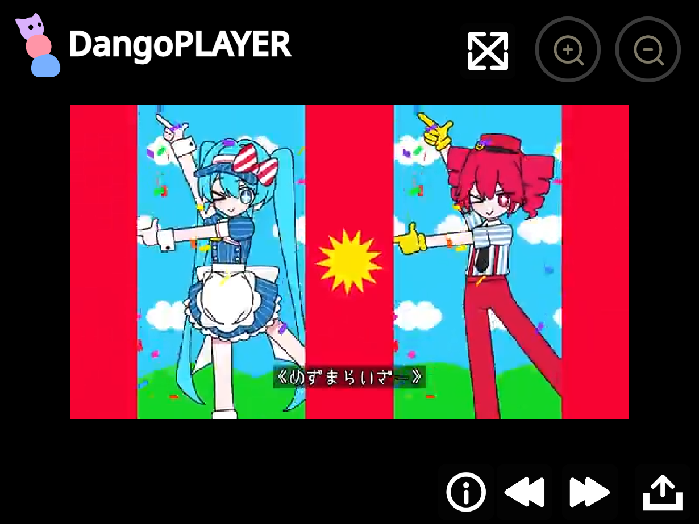

# DangoPLAYER

**An Open Source Video Player created in [CattyMod](https://cattymod.app).**

DangoPLAYER is a video player project made in CattyMod, designed to make watching videos simple and convenient. It supports local video files, video links, playback controls, and more!

## 🚀 Try DangoPLAYER

| Action | Link |
|---|---|
| 🎮 Open in CattyMod Studio | [Open DangoPLAYER](https://studio.cattymod.app/?project_url=https%3A%2F%2Fnoahscratch493.github.io%2Fdangoplayer%2Fdangoplayer.cmp) |
| 🌐 DangoPLAYER Web | [Open DangoPLAYER Web](https://noahscratch493.github.io/dangoplayer/player) |
| 📥 Download DangoPLAYER | [Download DangoPLAYER (.cmp)](https://noahscratch493.github.io/dangoplayer/dangoplayer.cmp) |

## ✨ Features

DangoPLAYER comes with a variety of features to make video playback easier:

- **YouTube Video Loading:** Load YouTube videos using embedded iframes. (Limited functionality due to iframe restrictions.)
- **File Uploading:** Upload and play video files from your device.
- **Fast Forward:** Skip forward through your video.
- **Rewind:** Go backwards through your video.
- **Pause / Play:** Easily pause and resume playback.
- **Load Video by Link:** Load videos using a direct video URL.
- **Zoom In / Out:** Adjust the video zoom level.
- **Fullscreen:** Watch videos in fullscreen mode.

## 📖 How to Use

1. Open DangoPLAYER using CattyMod Studio or download the project.
2. Load a video by uploading a file or entering a video link.
3. Use the playback controls to pause, play, fast-forward, or rewind.
4. Adjust the zoom level to your preference.
5. Switch to fullscreen for a larger viewing experience.

## ⚠️ Notes

- YouTube playback uses embedded iframes, so some features may be limited.
- Direct video links must point to video content that can be accessed by the player.
- Supported formats and playback capabilities depend on your browser.

## 🧊 Extensions Used

[Custom Styles](https://extensions.turbowarp.org/TheShovel/CustomStyles.js)

[Video](https://extensions.turbowarp.org/Lily/Video.js)

[Browser Fullscreen](https://extensions.turbowarp.org/veggiecan/browserfullscreen.js)

[Files](https://extensions.turbowarp.org/files.js)

[More Events](https://extensions.turbowarp.org/Lily/MoreEvents.js)

[Iframe](https://extensions.turbowarp.org/iframe.js)

[Runtime Options](https://extensions.turbowarp.org/runtime-options.js)

[Looks Plus](https://extensions.turbowarp.org/Lily/LooksPlus.js)

[Modals](https://cattymod.app/extensions/modals.js)

[I'm not a robot](https://cattymod.app/extensions/captcha.js)

[Network](https://extensions.turbowarp.org/true-fantom/network.js)

## 👀 Credits
All the extensions above were used to create DangoPLAYER.

The screenshot is playing [Mesmerizer by 32ki](https://archive.org/details/mesma).

The Play Icon and Zooming Icons are from [CattyMod](https://cattymod.app).

## 📜 License

DangoPLAYER is open source and licensed under the **MIT License**.

See [LICENSE](LICENSE) for details.

---

Created with ❤️ using [CattyMod](https://cattymod.app).
